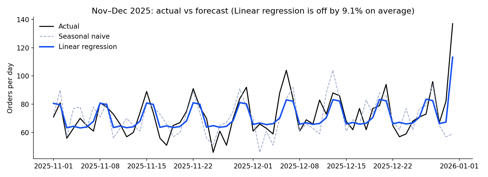
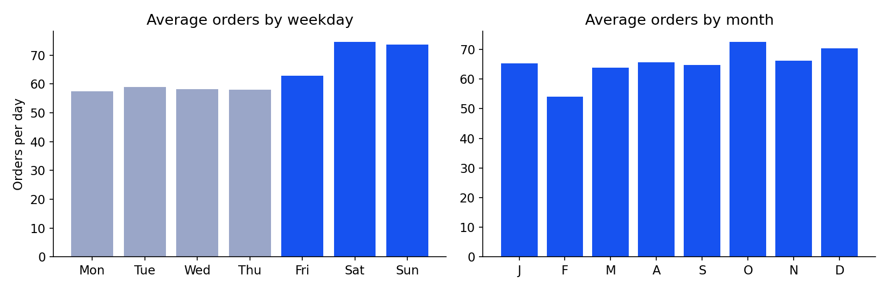
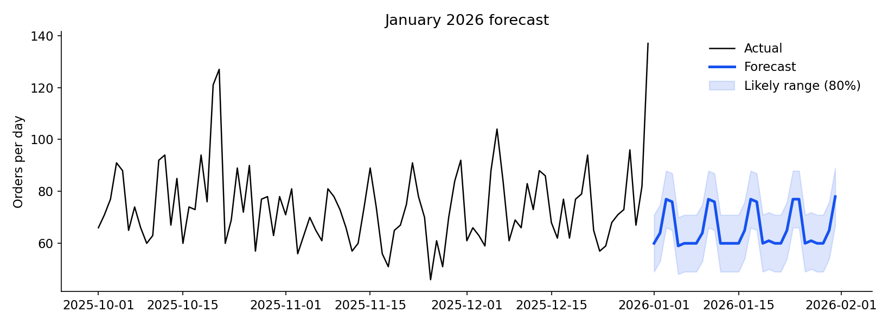

# Food Delivery Demand Forecast (Python)

Forecasting **daily orders for a Bengaluru food delivery hub**, then turning the forecast into a **delivery-partner staffing plan**.

**By Dibyanshi Poddar** · [Portfolio](https://dibyanshi29.github.io) · Python, pandas, scikit-learn, matplotlib · All data is fictional

This uses the same dataset as my [Power BI food delivery dashboard](https://dibyanshi29.github.io): the dashboard shows what *happened*, and this notebook predicts what *will* happen.

## Results at a glance

| | |
| --- | --- |
| Data | 46,338 orders, Jan 2024 – Dec 2025 |
| Best model | Linear regression with calendar features |
| Accuracy on unseen data (Nov–Dec 2025) | **9.1% average error**, vs 13.5% for a "same as last week" baseline |
| January 2026 forecast | **≈ 2,035 orders** (66 a day) |
| Staffing for the 8–9 pm peak | **5 partners** on weekdays, **6** on weekends |



## What I did

1. **Built a daily series** from individual orders with pandas.
2. **Explored the patterns:** orders grew 14% year on year, weekends are 25% busier than weekdays, and IPL season (Apr–May) and festivals (Diwali, New Year's Eve, Valentine's Day) cause spikes.

   

3. **Turned dates into features** a model can learn from: trend, weekday, month, monsoon, IPL season and festival flags.
4. **Compared three methods fairly** by hiding the last two months and testing on them:

   | Method | Avg error (MAPE) | Avg error (orders/day) |
   | --- | --- | --- |
   | **Linear regression** | **9.1%** | **6.5** |
   | Gradient boosting | 9.6% | 7.3 |
   | Seasonal naive (same weekday last week) | 13.5% | 10.0 |

   The simpler model won: with clear, repeating patterns, a well-designed linear model can beat a more complex machine-learning model.

5. **Forecast January 2026** with an 80% likely range.

   

6. **Converted the forecast into staffing:** 11.5% of a day's orders arrive in the 8–9 pm peak. Assuming a partner completes about 2 orders an hour, and planning for the busy end of the range, the hub needs 5 partners at peak on weekdays and 6 at weekends.

## Next steps

- Add weather data, since rain slows deliveries and shifts demand
- Forecast by area and by hour, not just by day
- Retrain monthly as new data arrives

## How to run it

```bash
pip install pandas scikit-learn matplotlib jupyter
jupyter notebook demand_forecast.ipynb
```

Or open `demand_forecast.ipynb` directly on GitHub to see it with all outputs and charts.

## Files

```
demand_forecast.ipynb   the full analysis, with outputs
data/orders.csv         46,338 orders (fictional)
images/                 charts used in this README
```
