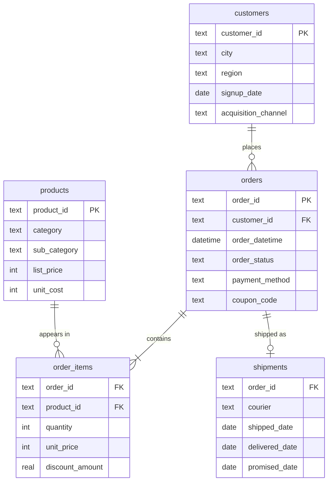

# E-commerce SQL Case Study

**15 business questions answered with SQL** on a two-year dataset from a fictional Indian online marketplace: 4,000 customers, 144 products, 27,960 orders and 55,798 order lines (Jan 2024 to Dec 2025).

The queries go from simple aggregations to **window functions** (`LAG`, `ROW_NUMBER`, `NTILE`, running totals), **CTEs**, **cohort retention**, **RFM segmentation** and **market basket analysis**.

**By Dibyanshi Poddar** · [Portfolio](https://dibyanshi29.github.io) · All data is fictional.

## Key findings

1. **Revenue is concentrated:** the top 20% of customers generate **71.8%** of revenue, and the "Champions" RFM segment (868 customers) brings in **74.2%**. Retaining them matters more than acquiring new customers.
2. **Retention is slipping:** month-1 retention fell from **70.7%** for the 2024-Q1 cohort to **25.8%** for 2025-Q3. Newer customers are not coming back as often.
3. **India Post is the weak link in delivery:** on time only **57.9%** overall and **32.4%** in sale weeks, against about 88% for other couriers. All couriers drop sharply during sales.
4. **Coupons don't grow baskets:** average basket before discount is about the same with or without coupons (≈₹6,000), so ₹96.2 lakh of discounts mostly gave away margin.
5. **Electronics leads revenue, Beauty leads margin:** Electronics brings ₹4.62 Cr at a 37.1% margin, while Beauty earns a 57.5% margin.
6. **Social media brings the most valuable customers:** ₹39,197 revenue per customer, the highest of any channel.

## Data model



**Net revenue** = quantity × unit_price − discount_amount, for delivered orders only.

## The 15 questions

| # | Business question | SQL techniques |
| --- | --- | --- |
| 1 | Business snapshot: size and fulfilment health | Conditional aggregation, subqueries |
| 2 | Monthly revenue with month-on-month growth | CTE, `LAG` |
| 3 | Revenue and gross margin by category | Multi-table joins |
| 4 | Top 3 products in each category | `ROW_NUMBER() OVER (PARTITION BY …)` |
| 5 | Running total of 2025 revenue | Cumulative `SUM() OVER` |
| 6 | Year-on-year growth by region | Conditional aggregation (pivot) |
| 7 | RFM customer segmentation | `NTILE`, `CASE` segmentation |
| 8 | Cohort retention by first-order quarter | Date arithmetic, cohort logic |
| 9 | Repeat rate and days between orders | `LAG` per customer |
| 10 | Pareto: revenue share of top 20% customers | `NTILE(5)`, share of total |
| 11 | Value of each acquisition channel | `LEFT JOIN`, `COALESCE` |
| 12 | Do coupons pay off? | Order-level aggregation |
| 13 | Return rate by category | Conditional sums |
| 14 | On-time delivery by courier, sale vs normal weeks | Date logic, conditional averages |
| 15 | Products bought together | Self-join |

All queries are in [`queries/case_study.sql`](queries/case_study.sql), and every result is saved as a CSV in [`results/`](results/).

## Selected results

**Q7. RFM segments**

| segment          |   customers |   avg_days_since_last_order |   avg_orders |   revenue_inr |   pct_of_revenue |
|:-----------------|------------:|----------------------------:|-------------:|--------------:|-----------------:|
| Champions        |         868 |                          34 |         20.4 |   101,451,517 |             74.2 |
| At risk          |         728 |                         140 |          4.3 |    17,847,201 |             13.1 |
| Lost             |         728 |                         354 |          2.8 |    11,942,493 |              8.7 |
| Loyal            |         331 |                          40 |          2.6 |     4,031,362 |              2.9 |
| New or promising |         256 |                          47 |          1   |     1,476,594 |              1.1 |

**Q8. Cohort retention**

| cohort_quarter   |   new_customers |   m1_retention_pct |   m2_retention_pct |   m3_retention_pct |
|:-----------------|----------------:|-------------------:|-------------------:|-------------------:|
| 2024-Q1          |             389 |               70.7 |               63.2 |               55   |
| 2024-Q2          |             359 |               51.5 |               48.5 |               44.8 |
| 2024-Q3          |             420 |               45   |               35.5 |               32.9 |
| 2024-Q4          |             376 |               33   |               28.7 |               29.8 |
| 2025-Q1          |             358 |               30.7 |               29.1 |               25.7 |
| 2025-Q2          |             367 |               26.7 |               24.3 |               28.3 |
| 2025-Q3          |             419 |               25.8 |               24.8 |               26.3 |

**Q14. Delivery performance by courier**

| courier      |   shipments |   avg_days |   on_time_pct |   on_time_normal_pct |   on_time_sale_pct |
|:-------------|------------:|-----------:|--------------:|---------------------:|-------------------:|
| Delhivery    |        8370 |        4.2 |          88.9 |                 90.3 |               69.9 |
| Ecom Express |        4246 |        4.2 |          88.2 |                 89.8 |               67.9 |
| BlueDart     |        6232 |        4.2 |          88   |                 89.8 |               64.3 |
| Shadowfax    |        4146 |        4.3 |          87.2 |                 89.2 |               61.6 |
| India Post   |        3020 |        5.7 |          57.9 |                 59.8 |               32.4 |

**Q3. Revenue and margin by category**

| category           |   net_revenue_inr |   gross_profit_inr |   gross_margin_pct |
|:-------------------|------------------:|-------------------:|-------------------:|
| Electronics        |        46,158,221 |         17,109,902 |               37.1 |
| Fashion            |        37,050,080 |         18,365,841 |               49.6 |
| Home & Kitchen     |        24,917,591 |         10,778,188 |               43.3 |
| Beauty             |        13,694,123 |          7,870,739 |               57.5 |
| Sports & Fitness   |         9,626,820 |          3,704,389 |               38.5 |
| Books & Stationery |         5,302,332 |          2,442,885 |               46.1 |

## Recommendations

- **Protect the Champions:** a loyalty programme or early sale access for the ~870 customers who drive three-quarters of revenue.
- **Win back the "At risk" group** (no order in about 140 days) with targeted offers before they become "Lost".
- **Move sale-week volume away from India Post,** or set longer promised dates for it, to protect on-time delivery.
- **Rethink blanket coupons:** they don't raise basket size; test targeted coupons for at-risk customers instead.

## How to run it

1. Download this repository.
2. Open `ecommerce.db` in [DB Browser for SQLite](https://sqlitebrowser.org/) (free), or run `sqlite3 ecommerce.db`.
3. Open `queries/case_study.sql` and run any query.

To rebuild the database from scratch: run `schema.sql`, then import the five CSV files in `data/`. The queries use SQLite syntax; for MySQL or PostgreSQL, replace `strftime` and `julianday` with the equivalent date functions.

## Files

```
ecommerce.db          ready-to-query SQLite database
schema.sql            table definitions with keys and constraints
data/                 the five tables as CSV
queries/              case_study.sql (all 15 questions)
results/              each query's output as CSV (Q1.csv … Q15.csv)
```
